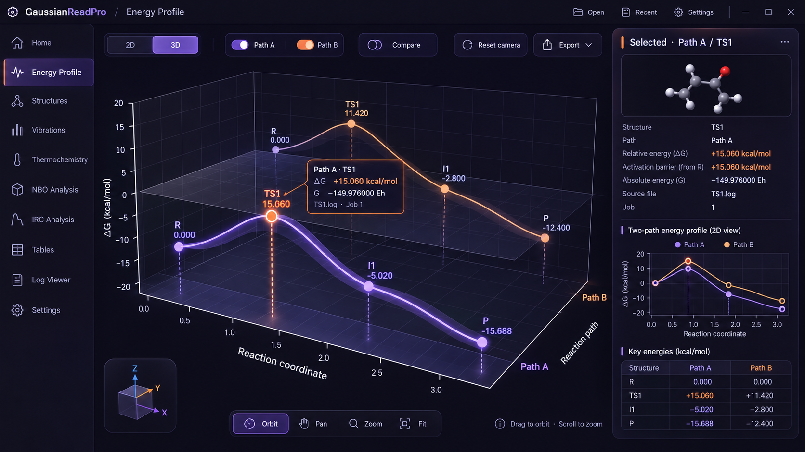
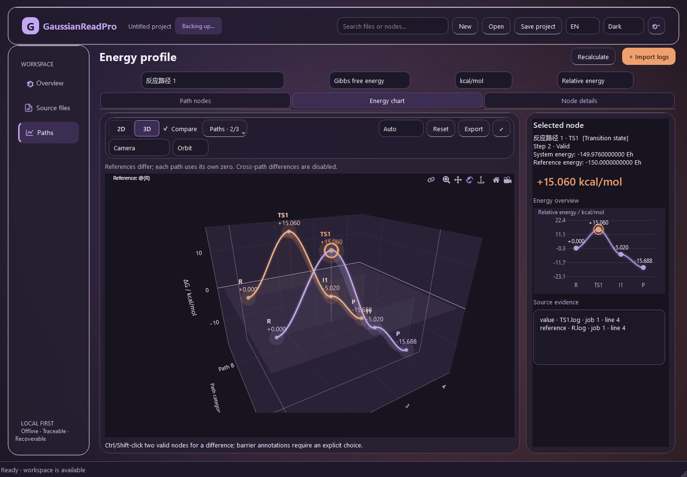

# 能量剖面工作台：参考图复刻实施指导书

版本：RF 1.0 · 2026-10-16。状态：**设计与代码核查完成；RF 实现尚未开始**。

用户要求：按下图还原完整界面质感与可操作的能量分析流程，补上明确的表达式保存入口。本文交给后续编码 AI 实施，不代表当前程序已具备这些效果。

## 0. 唯一视觉目标与完成定义



参考文件：`docs/design/energy-profile-replica-target.png`，1672×941 像素，SHA-256 `6F1C8818C046DF6FDAF6A63DBB4ABA5CC07B095CBC431F96B66C728FF8413D01`。必须打开图片观察；不能只读本文后凭印象实现。不允许生成另一张概念图替代实际程序截图。

对照现有 EP6 的实际程序截图：



“1:1”在本项目中的可检验定义：在固定窗口内容尺寸、DPR、语言、字体、数据和默认相机下，宏观布局、控件位置、材质层级、曲线高光、节点选择、面积虚影和右侧详情达到第 12 节阈值；按钮对应真实行为。跨操作系统的字体光栅化不承诺逐像素完全相同。

**允许的数值修正仅限参考图自身矛盾**：图中 Path A 的 TS1 标签出现 15.660，而详情/表格为 15.060；一些点的屏幕高度与纵轴读数不对应。不得为追求截图相似而给某条路径人为增加 Z 偏移。采用第 4 节统一数据，真实透视导致的位置变化记录在差异清单。除此之外，不能以“科学严谨”为由删掉高光、曲面虚影、节点、分子预览或工具条。

历史 EP1–EP6 的测试通过只说明当时功能与契约通过，**不能复用为本轮视觉复刻合格证据**。RF0–RF7 是能量页闭环；RF8 是图中其他导航模块的真实功能补齐。未完成 RF8 时只能宣称“能量页完成”，不能宣称整张图所代表的所有分析模块已完成。

## 1. 已核实的差距与代码事实

| 项目 | 现有实现 | 必须达到 |
| --- | --- | --- |
| 外框 | 大圆角顶部卡片、厚紫底、多层页签和选择框 | 50px 顶栏、196px 连续侧栏、近黑紫背景，主图从工具条下方直接展开 |
| 可用绘图区 | 图表在工作台卡片内再次套卡片，顶部重复控件 | 固定基准下主图约占 x=208…1264、y=128…930 |
| 相机 | 默认 `eye=(-1.1,-1.9,1.05)`，历史截图中图体偏小且倾斜 | Path A 前、Path B 后，X 从左向右，Z 朝上，图体填满主区域 |
| 材质 | 统一偏亮紫色，边框较强 | 深墨紫主底，细边框，局部玻璃高光，背景不抢占曲线 |
| 3D | 已有多层 scatter3d、mesh3d 光带/零面，仍呈默认绘图库观感 | 窄而明亮的曲线芯、柔和辉光、真实圆点、薄透明面积幕、弱网格 |
| 详情 | `PlotInspector` 为文本摘要、单路径小图、来源文本框 | 分子预览、键值详情、双路径二维图、双路径关键能量表 |
| 工具条 | 多行 Qt 按钮和下拉框；Plotly modebar 同时存在 | 顶部单行 2D/3D、路径开关、Compare、Reset camera、Export；底部独立操作条 |
| 方向指示 | 没有参考图的联动方向立方体 | 随实际相机更新，可点击标准视角 |
| 表达式保存 | `ExpressionDialog` 页脚只有“完成”；350ms 后自动 flush | 明确的保存按钮、目标项目、修订状态、失败重试和保存后关闭 |
| 科学能力 | 当前 `JobRecord` 主要为能量、作业元数据与诊断 | 分子预览需新增受来源校验约束的结构读取；不把示意分子当用户数据 |
| 导航 | 当前仅“概览 / 来源文件 / 路径”等工作台入口 | 与参考图一致的导航结构；每项真实路由，未实现模块如实标注 |

本轮核查入口：`ui/main_window.py`、`ui/profile_view.py`、`ui/plot_inspector.py`、`ui/profile_preview.py`、`resources/plot/profile.html`、`profile.js`、`core/plot_spec.py`、`ui/expression_editor.py`、`services/controller.py`、`services/session.py`。路径均相对于 `src/gaussianreadpro/`。

### 1.1 表达式现在究竟有没有存

- `ExpressionDialog.set_document/expert_changed` 在输入后启动 350ms 定时器；`flush()` 调用 `ProjectController.set_expression()`。
- `set_expression()` 更新内存项目并启动串行后台计算/恢复保存。其返回 True **不是磁盘保存完成通知**。
- `done()` 会等待脏草稿提交；目前点关闭/X/拒绝也不意味着撤销输入。
- `SessionBackend.save()` 才执行显式保存及错误检查；未命名项目必须先选择 `.grproj` 文件。
- 主窗口有“保存项目”及标准保存快捷键，编辑器里没有独立入口和可靠的完成状态展示。

因此不能描述成“完全没有持久化”，也不能把静态提示“均自动保存”当作用户可确认的保存结果。本轮要修复的是**显式保存操作、保存语义和失败反馈**，并通过重新启动读取磁盘文件验证实际行为。

## 2. 固定画布与布局规格

所有尺寸为 DIP/CSS px。DPR=1 时使用 1672×941 的应用内容区；系统窗口外部阴影不在比较范围。数值是按参考图建立的实现目标，不是从源设计文件提取的精确参数。

| 区域 | x / y / w / h | 实现规则 |
| --- | --- | --- |
| 全局顶栏 | 0 / 0 / 1672 / 50 | 底部分隔线 1px，无外层大圆角框；品牌及页面名在左，Open/Recent/Settings 和窗口操作在右 |
| 全局侧栏 | 0 / 50 / 196 / 891 | 右侧 1px 分隔线；不套悬浮卡；选中条橙色 3px、内部淡紫渐变 |
| 能量页内容 | 196 / 50 / 1476 / 891 | 承载一个 WebEngine 页面；不再包含旧“路径节点/图表/详情”横向页签 |
| 主图列 | 208 / 59 / 1056 / 871 | 顶部工具条、中央图层、底部工具悬浮条；不再套第二圈粗边框 |
| 顶工具条 | 216 / 69 / 1035 / 49 | 2D/3D 约 202px，路径开关约 247px，Compare 164px，Reset 151px，Export 143px，间隙见参考图 |
| 右侧卡 | 1272 / 59 / 387 / 854 | 16px 圆角、1px 低亮边框，内边距 18px；正常基准下内容不用滚动 |
| 详情标题 | 1290 / 76 / 352 / 29 | 左橙色短竖线，Selected · Path A / TS1，右侧省略菜单 |
| 分子视窗 | 1290 / 113 / 353 / 131 | 12px 圆角，深底，球棍模型居中；该区域必须真实绘制 |
| 详情字段 | 1293 / 258 / 348 / 184 | 标签列约 184px；值列右侧；行高约 28px |
| 详情分隔线 | 1290 / 455 / 353 / 1 | 低亮紫色 |
| 二维概览区 | 1290 / 471 / 353 / 237 | 标题、图例、绘图、轴标签；两条路径同时显示 |
| 关键能量表 | 1290 / 726 / 353 / 168 | 标题 + 表头 + R/TS1/I1/P 四行；选中行与节点一致 |
| 方向立方体卡 | 216 / 747 / 150 / 155 | 独立浮层，可交互；不能随绘图一起倾斜 |
| 底部工具条 | 477 / 854 / 441 / 56 | Orbit / Pan / Zoom / Fit；按钮选中紫色 |
| 操作提示 | 1028 / 877 起 | 14px 次级字；不遮挡轴或数据 |

页面内部推荐 CSS Grid：左列 `minmax(0,1fr)`、右列 `387px`、间隙 `8px`。上述 x 坐标包含 Qt 顶栏与侧栏偏移；WebEngine 内部换算时只减一次原点 `(196,50)`。用统一 resize 入口通知绘图，不叠加独立 resize 循环。

宽度适配：

- ≥1500：侧栏 196、详情 360–387，单行工具条完整标签；1672 为标准验收尺寸。
- 1200–1499：侧栏 176–196、详情 320–360；高级配置放进菜单，保留 2D/3D 与路径开关；不能把图压成小方块。
- 1000–1199：侧栏折叠为 64px 图标；详情可折叠，默认不覆盖选中点。
- <1000：详情改抽屉，侧栏收起，工具条图标配 tooltip；840×680 可完成选点、保存和导出，底部操作条可精简。
- 不通过整体缩放应用把 1672px 的界面塞进小窗口。DPR=1.5/2 只改变像素密度，不改变 DIP 尺寸。

Windows 可用自绘标题区实现图示，但拖动、最大化、最小化、双击、窗口缩放和系统快捷键都必须有效。macOS/Linux 保留平台必要窗口控件；跨平台验收比较内容区，不能通过禁用原生操作换相似截图。

## 3. 颜色、文字、图标、材质

新增**能量工作台专用 tokens**到现有主题资源，并让 Qt/CSS/绘图共用同一映射；不可散落硬编码，也不可直接改所有页面的旧 dark 色导致未检查页面回归。参考模式默认为深色，浅色模式继续支持。

| token（建议名） | 深色目标 | 用途 |
| --- | --- | --- |
| profile.canvas | #0D0C19 | 主背景 |
| profile.header | #10101F | 顶栏 |
| profile.sidebar | #121020 | 侧栏 |
| profile.panel | rgba(24,22,41,0.86) | 右详情、浮层 |
| profile.panel_highlight | rgba(54,46,83,0.22) | 顶缘渐变与局部高光 |
| profile.border | rgba(126,108,181,0.32) | 卡片和控件细边 |
| profile.grid | rgba(133,125,172,0.14) | 三维网格 |
| profile.axis | #C1BCD7 | 轴与刻度；透明度按层级降低 |
| profile.text | #EFECFF | 主文字 |
| profile.muted | #BCB5D8 | 次级文字 |
| profile.path_a | #AD83FF | 薰衣草紫路径 |
| profile.path_b | #FFA96C | 落日橙路径 |
| profile.focus | #FF9B61 | 选中圈、投影线及详情能量 |
| profile.curve_core | #E9D8FF | 紫色路径高光线芯，其他路径按本色混合白色 |

这些是待实测微调的初值；RF2 校准完成后冻结。不得在每个后续阶段重新发明配色。

材质：卡片为近黑紫透明填充 + 极弱纵向渐变 + 顶部细亮边 + 低强度外阴影。不能堆叠高亮白框；不能让整个主图背景变成紫灰大平面。图表内部不使用大面积模糊，以保证数值清晰。玻璃感来自边缘、透明度和层次，而非全屏发光。

字体：英文优先 Segoe UI，中文 Microsoft YaHei；跨平台使用已确认许可的本地替代字体，并记录实际字体。品牌 20–21px/600；详情标题 18px/600；导航 15px；正文/工具条 14–15px；数据标签 16–18px；轴刻度 14–16px。数字采用 tabular-nums，正负号与小数点对齐。不要在桌面截图中把正文降到 10–11px。

图标：统一 24px、约 1.7px 描边、圆端点；独立 SVG 图标文件，禁止 emoji 充当按钮图标。应用窗口图标沿用用户已经确认的头像；参考图左上的齿轮可作为产品页面图形，不得擅自替换用户头像资产。状态悬浮提示使用 120–180ms 透明度/边框过渡；尊重减少动效设置，不持续呼吸或闪烁。

## 4. 演示数据与科学规则

创建新的**明确标记为合成示例**的 fixture，专供一致性截图与测试。保留真实数据模式，不把样例写入生产默认项目。样例路径必须有独立节点 UUID，不能简单复制共享节点后改名称，导致两条路径能量一样。

| 节点 | X | Path A / kcal·mol⁻¹ | Path B / kcal·mol⁻¹ |
| --- | --- | --- | --- |
| R | 0 | 0.000 | 0.000 |
| TS1 | 1 | +15.060 | +11.420 |
| I1 | 2 | −5.020 | −2.800 |
| P | 3 | −15.688 | −12.400 |

Path A 可沿用现有 oracle 的完整精度：`0, +15.0602273775, −5.0200757925, −15.6877368516`，显示三位小数。例如 A 参考 −150 Eh，TS1 为 −149.976 Eh；使用项目现有单位常数计算，不能在界面写死转换系数。Path B 根据表中展示目标通过同一核心换算生成合成绝对值。两条路径采用同一参考表达式快照及可比较的能量类型；来源引用/参考签名符合现有比较契约。

默认场景：英文、深色、3D、两路径可见、A 在前、选中 A/TS1。A 的 R 已被显式设为该 TS 的势垒前驱，才允许详情显示 `Activation barrier (from R)`。普通用户项目没有这个选择时显示“未设置前驱”，不能默认第一个节点就是势垒基准。

规则：X=步骤/已定义反应坐标，Y=离散路径类别，Z=真实能量。当前项目无物理反应坐标数据，轴标明确写 `Reaction coordinate (step)` 或本地化短文案，不暗示 Å 等物理长度。相对 Gibbs 显示 ΔG，电子能显示 ΔE；直接差值不再减参考。缺值断线且显示 —；所有面、线与点来自同一 payload。显示采样不参与能量、势垒或 CSV。

Path A/B 的相对比较不得因图像相似绕过 `reference_signature` 校验。存在不同参考时允许按现有规则独立显示并明确提示，禁用不能成立的跨路径差值。

## 5. 实现架构：专用能量页，不再给旧图表套皮肤

保留 Python/PySide6、科学核心、SQLite、SessionBackend、离线资源、现有协议信封。Qt 负责全局顶栏/导航、项目生命周期、原生文件对话框和表达式编辑器；**整个能量页内部（工具条、3D/2D、详情、小图、方向立方体）由现有一个 QWebEngine 页面组成**。这样右侧卡、悬浮层和绘图共用布局坐标，不会出现 Qt 与 Plotly 各自渲染一套工具栏。

### 5.1 渲染方案定案

- 3D 采用本地 vendored Three.js 的专用 renderer，以实现可控的相机、细光芯、屏幕尺寸节点、透明幕和准确锚定的 HTML tooltip。不用默认 Plotly scatter3d 外观作为新视觉交付；旧 renderer 保留为过渡回退。
- 2D 主图可继续使用已有 Plotly 的数值点与 `curve_runs`，隐藏默认 modebar、背景和图例，接受统一工具条控制。右侧小图用 SVG/Canvas 绘制相同显示采样，不能另算一套曲线。
- 3D 新增局部辉光/透明层会涉及 renderer、线宽和投影坐标，单独在 RF3 验证；禁止顺便修改公式核心。
- 库版本、许可及随包哈希在 RF0 锁定。所有 JS、字体和图标离线，不能依赖 CDN。先检查当前 Qt WebEngine 的 WebGL2 与模块支持，再选择兼容版本；本文不猜测 API 版本。
- 若目标环境无法使用新 renderer，明确显示降级原因并回退 2D；“降级成功”不算 3D 复刻验收通过。

### 5.2 建议新增文件与边界

以下为建议新文件；实施时在进度中记录最终路径。

| 文件/目录 | 责任 |
| --- | --- |
| `resources/plot/replica.css` | 页面网格、玻璃卡片、按钮、tooltip 和响应式 |
| `resources/plot/scene3d.js` | 主 3D 场景、透明层、pick、相机；无科学求值 |
| `resources/plot/profile_controls.js` | 页面行为、操作模式、选点/详情同步 |
| `resources/plot/inspector_view.js` | 详情字段、两路径小图、关键能量表 |
| `resources/plot/molecule_view.js` | 已验证结构的球棍预览 |
| `resources/plot/vendor/` | 本地依赖、许可和哈希清单 |
| `presentation/profile_view_model.py` | 从核心结果生成详情/概览/表格 DTO，不重新计算科学值 |
| `services/structure_preview.py` | 在指定 source/job 范围读取坐标，校验来源；异步、可取消 |
| `tools/check_profile_replica.py` | 固定 fixture、截图、真实交互、报告 |
| `docs/energy-profile-replica-progress.md` | RF 阶段事实与证据 |

现有 `profile.js` 保留为调度/桥接入口或逐步拆分，避免把全部代码继续堆在一个文件。旧 `PlotInspector` 迁移到新 DTO 后移出能量页的重复显示；别处仍使用的原生后备保留。

### 5.3 桥接和状态

每个选点/编辑/保存/导出事件附 `project_id/revision/render_id`；点身份用 `path_id + entry_id`，来源用 UUID+job_id。沿用协议 2 的已支持事件；新增事件走显式白名单、参数校验及双端版本能力声明，不接受网页传入任意 Python 方法名或文件路径操作。

允许新增只描述展示的 `visual_style`、结构 DTO、详情 DTO。JS 不能从两个舍入后的标签相减计算势垒。所有用户文本使用 textContent/安全转义，不拼入 HTML。

建立 `ProfileRenderer` 适配边界：`mount/setData/setSelection/setViewport/resize/capture/dispose`。2D/3D 切换保留同一 selection，两个 renderer 独立 viewport；主页面只有一个桥接监听器。3D 视图在不可见时停止 RAF，不重复建立 WebEngine/scene/material/event listener。

已有 Plotly 相机 `{eye,center,up}` 与 Three.js camera 归一化空间不同，RF3 必须实现显式转换并回归旧项目。新状态建议在 `plot_state` 中加入有版本的 renderer viewport 扩展，继续经过 `clean_view_state` 白名单；不要静默重新解释旧坐标。SQLite schema 保持 v1，JSON 扩展缺省时使用新默认镜头，非法值安全回退。

## 6. 3D 必须达到的渲染效果

### 6.1 构图与相机

- X 轴从左前向右前展开，Path A 在前，Path B 在后，Z 向上；旋转坐标系时不得把某条路径能量乘系数或平移以凑图。
- 主图包围盒占中央可用图区宽约 88–94%、高 76–86%；不得像历史图只占中央一小块。
- 先在正确数据上用投影相机标定构图：正交作为稳定起点，若使用透视则采用约 30–38° 的初始 FOV；最终选择固定一种并写入基准 manifest。相机位置是待截图校准参数，不能把这组范围当已验证效果。
- Z 基准样例可设 −20…20，零面与真实零值一致。图示错误的零值高度不作为锚点硬约束；相机中所有真实点必须同用一套轴变换。
- 使用 `fitBounds` 根据数据范围/标签边距计算距离与目标点；只在首次、明确 Fit 或视口失效时执行。选点、更新右栏、切换语言不能重置相机。

### 6.2 曲线、节点与虚影的绘制顺序

| 层 | 建议初值（屏幕 px/透明度） | 验收重点 |
| --- | --- | --- |
| 深色场景/弱网格 | 网格 1px、alpha 0.10–0.16 | 不形成亮紫色盒子 |
| 地板与零平面 | 地板淡紫 alpha 0.04–0.07；零面 0.06–0.10 | z=0 正确，不盖住曲线 |
| 面积投影幕 | 顶边为曲线，底边为统一地板 z_min；顶 alpha 0.10–0.16，向下衰减到 0 | 连续透明“面积虚影”，绝不能使用厚不透明墙 |
| 曲线下方窄光带 | 约 8–16px 的视觉厚度、alpha 0.12–0.22 | 与主曲线同形，贴着曲线；不是跨路径曲面 |
| 曲线外光 | 约 12–20px、alpha 0.05–0.10 | 柔软辉光，不能呈硬边半透明粗管 |
| 曲线内光 | 约 5–9px、alpha 0.15–0.25 | 收敛到中心线 |
| 线芯 | 约 2–3px，中心混白 | 连续、清晰、有亮边，不发灰 |
| 真实数据点 | 直径 14–18px；TS 选中核心约 18px | 球状/圆润，有微亮高光，缩放后可识别 |
| 当前选中 | 外环 24–28px、2px 橙边+细白边，外晕 32–40px | 鼠标移开仍保持，A 曲线颜色不被整体改橙 |
| 投影虚线 | 普通点 alpha 0.35–0.5；选中橙色 1.5–2px | 从点准确投到指定平面；不影响选点 |
| 标签与 tooltip | 屏幕空间覆盖层 | 始终朝向屏幕，不被玻璃面错误遮蔽 |

面积幕与节点垂线的终点必须统一且有语义：本设计装饰幕投到场景底板 `z_min`，零平面独立标记。不能把底板投影误称为 ΔG 数值或势垒。每条路径独立成面；不同路径之间不得插值出“势能面”。

曲线继续使用核心已有 `curve_runs` 的保形分段采样；检查节点恰好经过、没有超过相邻端点范围、无效处断开。渲染层可以增加仅用于抗锯齿的细分，不能改变走势或物理节点。

不依赖 WebGL 原生宽线一定支持 width>1；使用随版本锁定的宽线实现或 billboard strip。光晕使用带径向 alpha 的 sprite/材质或受限 bloom；alpha 混合、颜色空间、tone mapping 统一，文字/UI 不参与 bloom。光幕 `depthWrite=false`，透明对象排序稳定；在前后旋转时核对交叉遮挡。透明装饰不进入 raycast 对象集合。

### 6.3 标签、tooltip 与方向指示器

- 两行节点标签：`TS1` / `+15.060`，普通点淡紫或路径色，选中橙色。四点两路径默认全部可读；不能因为“密集策略”把标准样例的大部分标签藏掉。
- 普通标签使用候选位置+包围盒避让；选中优先。可拖动标签时只保存屏幕偏移，不移动科学节点。
- 悬浮卡约 200–240px 宽，深紫玻璃底、1px 橙/路径色边、10–12px 圆角；显示路径·标签、ΔG+单位、绝对能量、来源文件·Job。多来源显示“多个来源”并可展开，不能只显示第一个文件冒充全部。
- 屏幕投影使用当前 camera/view/projection 和实际 canvas rect；tooltip 避开窗口边、右栏、选中标签。旋转、resize、DPR 变化后重新计算，禁止写死点的像素位置。
- Hover 是暂时预览；Click 是持久选择并固定详情卡，移开鼠标后仍保持选中。Escape 先取消临时 hover/比较，再按上下文关闭抽屉。
- 方向立方体采用同一 camera quaternion 的反向视图映射，正确标 X/Y/Z；点击面/轴设置对应预设。鼠标在立方体上不触发主场景 orbit。不能画一个静止 SVG 立方体冒充联动控件。

## 7. 右侧详情与结构预览

右栏固定顺序：标题 → 分子 → 详情键值 → 分隔 → 双路径 2D 小图 → 关键能量表。不能替换为大段多行纯文本。

详情字段为 Structure、Path、Relative energy、Activation barrier、Absolute energy、Source file、Job；CN/EN 成对。主能量和已设置的势垒用橙色，普通值用主文字色。Source file 可点击进入对应作业和行号的 Log Viewer；表达式多来源用展开列表保留所有来源、类型、SHA 及行号。右上菜单提供“编辑表达式”“定位来源”“复制数值”“显示/隐藏详情”。

小图两路径同时绘制，真实点、细曲线、零线、X/Z 轴和路径图例齐全；主图选中点为橙环，小图与表格反向点击也能选主图。表格按显式步骤对应关系匹配，不能只按标签字符串或数组索引配对异长路径。未匹配项显示 —，同名节点用 ID 消歧；单路径只展示一列。

### 7.1 分子视窗不是装饰图片

当前核心没有可直接供该视窗使用的原子坐标模型。新增结构预览读取必须限定在已绑定 source/job 的起止行内：优先该作业最后一个完整 Standard orientation；按明确规则回退 Input orientation。识别原子序数、有限 XYZ、单位与行号；不跨作业借坐标。记录所用 orientation 类型、来源 SHA、job_id 和坐标段行号。

坐标读取放 worker，可取消、限大小；显示前验证来源未变。缓存按 source SHA/job_id/解析版本构建，只作可重建展示数据，不偷偷更改能量解析的身份算法。若必须改现有解析器版本，应另做 ID/旧项目迁移评审与测试。

球棍外观：C 银灰、H 白、O 红、N 蓝；柔和顶左主光与环境光，背景近黑紫；模型占视窗宽约 60–70%。用户拖动旋转、滚轮缩放、双击复位；无手动操作时保持静止。连接键可按明确的共价半径启发式推断，但标明为显示用推断，不能暗示化学键级已计算。

表达式可能组合多个分子；提供来源选择器，默认不任意断言某一分子就是整个体系。无可用结构时显示“此作业没有可用结构”，不显示硬编码苯环。演示 fixture 可以包含专门编写的合成坐标，但必须标记示例。分子预览可以使用同页第二个小 canvas/renderer，不能再开一个 QWebEngine；选择切换释放旧 geometry/material，离开页面停止渲染。

## 8. 所有可见控件的功能契约

| 控件/操作 | 必须发生的结果 | 状态/边界 |
| --- | --- | --- |
| 2D / 3D | 主视图切换，选中节点及两路径一致 | 各自 viewport 持久化，切换不重新计算科学值 |
| Path A / Path B 开关 | 切换对应曲线、点、面积幕、图例与比较列的可见状态 | 支持全隐藏的明确空状态；隐藏已选路径则清除活动图点或提示，不留漂浮光环 |
| Compare | 开启/关闭多路径对比 | 与路径显隐分别管理；参考不兼容时提示并禁用差值，不假造共同参考 |
| Reset camera | 恢复本设计默认相机 | 不等于恢复上次保存镜头；后者在菜单另列 |
| Export | 打开格式/画面范围/主题选择 | 3D PNG/HTML；2D PNG/SVG/PDF/HTML；保留现有审计结果包 |
| Orbit | 左键拖动旋转 | 明确选中态；点击和拖动以阈值区分，拖动结束不误选点 |
| Pan | 左键拖动平移 | 滚轮仍缩放，保留中心/目标点 |
| Zoom | 拖动调整尺度或距离，支持 +/− | 有合理近远限位，不穿过曲面或翻转画面 |
| Fit | 适配当前可见路径与标签 | 不改数据，也不覆盖默认相机定义 |
| 鼠标滚轮/触控板 | 以稳定速度缩放 | 页面不整体滚动，详情滚动区例外 |
| 点击真实节点 | 主图、详情、小图、表格一致选中 | path_id+entry_id；同名不串选 |
| 双点比较 | 提供明确的第二点选择反馈与清除入口 | Python 返回差值，不用 JS 标签相减 |
| 势垒 | 明确指定 TS 与相邻前驱再添加 | 未指定不自动画括号、不捏造 ΔG‡ |
| 编辑表达式 | 打开对应节点/路径的原生编辑器 | 保存链见第 9 节，关闭后更新所有关联视图 |
| Open / Recent | 导入日志或打开项目，Recent 打开指定项目 | 文案/菜单区分日志和项目；文件缺失可重连 |
| Settings | 语言、主题、减少动效、显示设置 | CN/EN 即时切换，不重置选择或项目数据 |
| 键盘 | Tab、Enter、Space、Escape、方向键浏览节点，标准保存快捷键 | 图不是仅靠鼠标操作；选中信息有可访问文本 |

2D 主图继承此前二维参考图：平滑紫色发光曲线、圆点、橙环、清楚的零线与投影、悬浮卡及已显式设置的势垒括号；不得重新退回水平短横线。2D 与 3D 使用同一 DTO 和颜色，独立保存缩放范围。

## 9. 表达式保存：优先修复的独立任务 RF1

### 9.1 用户可见设计

编辑器底部使用固定 footer，不随组分列表滚出屏幕。左侧为**动态状态+目标项目路径/名称**；右侧为：

1. `保存表达式 / Save expression`：保存到当前 `.grproj`，保留编辑器打开；快捷键 Ctrl+S，macOS 对应标准保存键。
2. `保存并关闭 / Save and close`：完成同一保存链，成功后关闭。
3. `关闭 / Close`：保留现有自动草稿行为；未命名/失败时明确提示保留恢复副本、另存为或继续编辑。不可把它命名“取消”却已经自动应用输入。

允许无效表达式保存为草稿；按钮根据状态显示“保存草稿”，旁边明确“草稿不可计算”。保存成功绝不能恢复上一个有效结果蒙混过关。路径参考表达式采用相同入口。

若产品另行加入“撤销本次编辑”，必须明确记录打开时的文档快照并作为新的修订回滚；不在本次自动保存修复中偷偷改变撤销语义。

### 9.2 状态机与异步竞态

区分：`editing`（当前输入未提交）、`applying`（等待后台接收）、`backed_up`（恢复副本已落盘）、`saving_project`（项目文件提交中）、`saved_project`、`save_failed`。语法是否有效与保存状态正交，不把“语法正确”当“已保存”。

推荐单次显式保存链：

```text
用户点击保存（记录 editor generation + project_id + node/path ID）
→ 停止防抖，提交当前 draft 与组分 UI 状态
→ 如果 controller busy，排队这次保存意图，不能 return False 后丢掉
→ 等待对应 revision 的 apply/后台处理完成
→ 未命名/只读项目选择目标 .grproj；取消选择则留在编辑器
→ controller.save(destination)，等待对应 project/revision 的结果
→ 确认目标 repository 的 saved_revision 覆盖本次请求，且没有更晚的未提交输入
→ 状态为“已保存到 项目名 · 时间”；若是保存并关闭才关闭
```

为降低首版复杂度，显式保存期间暂时冻结编辑区域并保留进度/取消文件选择；自动草稿提交期间仍允许输入。若选择实现保存期间可继续编辑，则必须给编辑版本编号，旧保存回调不得把新输入标成已保存。不得新增并行 worker 绕开现有串行 SessionBackend。

连接到真实 `statusChanged`、成功/失败信号及请求标识。不能仅根据 `busy=false` 判断保存成功，不能仅根据内存 revision 或 `_dirty=false` 更改成功文案。保存失败时编辑器保持打开、草稿保留、提供重试/另存为；磁盘写失败的诊断不覆盖表达式语法诊断。

未命名项目自动恢复成功显示“草稿已备份，尚未保存为项目”；已命名项目显示实际提交路径。只读项目先另存副本再编辑/保存，绝不写原文件。保存同一文档但改过组分选择等工作区状态时也必须持久化最新 workspace，不因表达式文本相同提前忽略。

### 9.3 必测用户场景

| 场景 | 验收结果 |
| --- | --- |
| 新项目改表达式，点保存 | 弹出项目文件选择；成功后显示路径，关闭整个程序再打开仍是该表达式 |
| 已命名项目快速输入后立即 Ctrl+S | 最后一个字符、系数、单位和引用都保存，不保存旧修订 |
| 后台忙时点保存并关闭 | 意图排队，成功才关闭，不悄悄丢弃 |
| 编辑无效语法 | 草稿可保存/恢复；主图对应节点为空值，不能继续显示旧结果 |
| 取消保存路径选择 | 编辑器仍打开，状态为未保存到项目；内容不丢 |
| 只读/目录不可写/文件锁 | 明确失败或另存为，不能出现成功提示 |
| 关闭按钮、X、Escape | 行为一致且提示清楚，不把关闭等同撤销 |
| 节点表达式和路径参考 | 分别保存并重启恢复，reference 只减一次 |
| 有更晚输入或切换项目 | 旧回调被拒绝，不串写另一项目/节点 |
| 840×680 / 125% / 150% / 200% | footer 始终可见可点击，不被窗口底部截断 |

不要只测构造一个对象再读回；至少一次通过真实 Qt 编辑、点击保存、退出应用、重新启动并读取同一磁盘项目。

## 10. 导航模块与“完整功能”的范围

参考图侧栏顺序：Home、Energy Profile、Structures、Vibrations、Thermochemistry、NBO Analysis、IRC Analysis、Tables、Log Viewer、Settings。每项图标、间距、选中态按参考图实现；基准截图只选 Energy Profile。

本库现有能力不足以直接宣称每个模块完整。实现时不能把所有条目导向同一旧“路径页”，也不能做成无响应的摆设。RF2 可建立路由及明确的未实现页面，RF8 才交付以下真实最小功能：

| 模块 | 完整功能最低要求 | 依赖与验收 |
| --- | --- | --- |
| Home | 新建/打开项目、最近记录、恢复副本、导入日志 | 沿用现有 session/recovery，不重写存储 |
| Structures | 指定文件/作业的结构查看、旋转、坐标表/导出 | 复用 RF4 坐标读取；来源及单位可追溯 |
| Vibrations | 读取频率/虚频、列出模式；若提供动画，必须使用真实位移向量 | 当前需新增解析和独立 oracle；没有位移不伪造动画 |
| Thermochemistry | SCF/Gibbs correction/Gibbs total、温度/压力、作业来源 | 先使用现有字段；未解析量显示不可用，不能把校正当总自由能 |
| NBO Analysis | 支持明确列出的 NBO 输出版本/节，表格、搜索与来源定位 | 独立受控样本与解析测试；未支持格式明确提示，不宣称全版本兼容 |
| IRC Analysis | 按明确的 forward/reverse 分支读取步骤/能量，选择点并关联结构 | 区分无 IRC 数据和解析失败；不得拿普通能量路径冒充 IRC |
| Tables | 当前项目真实节点、来源、路径数据筛选与 CSV 导出 | 同一结果 DTO，不重复科学计算 |
| Log Viewer | 文本查看、搜索、作业/行号定位 | 大文件按需加载，用户文本不得按 HTML 执行 |
| Settings | CN/EN、主题、动效、本机偏好 | 立即生效，重启恢复，偏好不写科学项目修订 |

RF8 按模块拆分小任务；新增解析契约单独评审与迁移测试。缺少样本时先列清输入格式及阻塞项，不能以假数据填充用户页面。该模块补齐不应阻塞 RF1 的保存修复交付。

## 11. 分阶段交给编码 AI 的顺序

每阶段只读取本节指定文件、前阶段交接和必要依赖。低成本编码模型适合确定的布局/文案/小范围测试任务；RF3 的投影、透明混合和相机迁移，RF1 的异步保存竞态先做小原型与测试，连续两次修复不能通过时再交给更强模型审查。不要靠反复增加“科技感”形容词重做整个项目。

| 阶段 | 本阶段交付 | 主要代码范围 | 阶段门槛 |
| --- | --- | --- | --- |
| RF0 基线/夹具/资源 | 复现现有程序截图；锁定合成双路径、字体、目标区域、依赖版本/许可；记录 source/EXE 哈希与实际 renderer | `tools/check_profile_replica.py`、独立 fixtures、资源 manifest | 固定数据所有显示数值一致；确认没有旧 EXE 或回退视图混入截图 |
| RF1 明确保存 | 编辑器保存/保存并关闭、动态状态、失败重试、重启验证 | `ui/expression_editor.py`、controller/session 保存链、locale、相关测试 | 第 9.3 节通过；无需等待视觉重构完成 |
| RF2 外框/页面布局 | 顶栏、侧栏、专用页面 Grid、tokens、统一工具条与右栏占位布局 | `main_window.py`、`profile_view.py`、HTML/CSS、主题/locale | 1672×941 宏观边界通过；不许用多层旧工具条充数；占位不算 RF4 完成 |
| RF3 真实 3D | Three renderer、高光/点/光环/透明幕/网格、默认镜头、pick、方向立方体 | `scene3d.js`、bridge 适配、视图白名单、显示字段 | 真 Qt/WebGL 旋转、选择、透明排序、相机迁移；所有装饰层不抢选点 |
| RF4 完整详情 | 实际分子预览、键值区、双路径小图、关键能量表与选中联动 | DTO、结构 worker、`inspector_view.js`、`molecule_view.js` | 图/表/详情一致；来源缺失、组合表达式不伪造分子 |
| RF5 2D/交互 | 2D 视觉对齐、所有工具条行为、键盘、路径显隐/比较、宽窄适配 | controls、2D adapter、locale | 第 8 节逐项可操作；选择跨视图保留，Tooltip 不卡在旧位置 |
| RF6 状态/导出 | 项目重开恢复、新 renderer 离线导出、显示截图导出、错误恢复 | `plot_export.py`、profile_view、资源打包、状态测试 | 离线 HTML 真正运行新 3D；PNG 对应当前 renderer，保留审计清单 |
| RF7 视觉与发布物复验 | 区域截图对比、科学/交互回归、性能、当前 Windows EXE 实测与交接 | 验收脚本、打包清单、进度/报告 | 第 12 节通过；包内新 JS/图标/字体哈希一致，截图源自该 EXE |
| RF8 侧栏各分析模块 | 按第 10 节逐模块实现/验证 | 专门解析器/模块页面/来源测试 | 无占位模块才允许称“整张图的功能完整复刻” |

RF7 可以构建本地可检查的 Windows 包；本轮指南本身不发布新 Release，不覆盖远端已发布文件。RF 阶段不等同原总计划 S8/S9，也不改写历史 EP/G 的完成事实。

### 11.1 通用执行提示词

```text
阅读 AI_HANDOFF.md 的最新 RF 入口、docs/ENERGY_PROFILE_REPLICA_GUIDE.zh-CN.md
和 docs/energy-profile-replica-progress.md，只执行 RF<n>。
必须打开 docs/design/energy-profile-replica-target.png 与当前实际截图对照。
按该阶段代码范围完成实际功能，不用静态图片或假数据冒充生产界面。
Python 科学核心、UUID/来源、串行保存、当前项目修订校验保持有效。
功能测试和视觉验收分开记录；历史 EP6 通过不是本轮验收证据。
修改后运行相关测试，提供真实 Qt 截图/导出实物/重启恢复证据。
更新进度：修改文件、命令、通过/失败、截图、已知差异与下一阶段。
不得自动跳到后续 RF 阶段，不启动 S8/S9，不自行发布 GitHub Release。
如果测试环境无法启动真实 WebGL，记录阻塞，不能宣称 3D 已完成。
```

RF1 专用补充：`不要只把“完成”改名。必须实现 flush → 等待正确修订 → 项目落盘 → 验证状态 → 成功后关闭的完整链；新增项目要弹出文件保存对话框；失败保持编辑器和草稿。`

RF3 专用补充：`截图验收必须看默认相机，不允许人为旋转到另一个视角再声称默认符合。节点真实能量不平移；透明幕、选择圈和方向立方体都要在相机旋转时正确。`

RF7 专用补充：`分别报告源码运行和发布包运行。用户看到旧界面时先核对 EXE 路径/哈希、资源哈希、renderer 与降级原因，而非再次在错误程序实例上截图。`

## 12. 验收标准：功能通过与视觉通过必须同时满足

### 12.1 固定截图场景

固定 1672×941 DIP、DPR=1、EN、dark、上述双路径数据、默认相机、A/TS1 选中。动态时间、光标位置、系统外框从比较中排除；tooltip 通过真实选点固定，而非事后贴图。另测 CN、1440×900、1100×820、840×680，DPR=1/1.5/2；浅色作为可用性回归，不与深色目标直接做像素比较。

必须至少提交这些**真实程序截图**：

1. 3D 默认构图（选中 TS1、详情展开、透明幕可见）。
2. 3D 旋转后、Pan 后、隐藏 B 后各一张；方向立方体同步。
3. 2D 两路径与同一选中点；CN 版本。
4. 表达式保存前、保存成功、保存失败和再次启动后读取的状态。
5. 窄窗详情抽屉与高 DPI 页脚；Windows 冻结 EXE 的默认 3D。

同时录制短交互证据或保存带操作/坐标/结果的验收日志：旋转→选点→详情/小图/表格联动→编辑→保存→退出→重开。仅截图无法证明“功能完全复刻”。

### 12.2 可量化的视觉门槛

以下是新验收目标，不是已测结果；RF0 建立裁剪坐标与对比脚本，RF7 输出实际测量值。

| 项 | 通过条件 |
| --- | --- |
| 大区域边界 | 基准尺寸下顶栏/侧栏/右栏/工具条边界误差 ≤4 DIP；不多出旧页签或工具栏 |
| 主图占用 | 图体包围盒达到第 6.1 节范围，不发生大面积无意义空白 |
| 静态 UI 锚点 | 标题、主要按钮、卡片和表格起点误差 ≤6 DIP |
| 控件与文字 | 标准字号误差 ≤1 DIP；无裁切/重叠；至少 WCAG AA 目标对比度，测量记录实际值 |
| 背景色 | 选取无渐变/无文字基准区域，RGB 单通道中位误差目标 ≤8/255；其余材质人工核对 |
| 选择效果 | 真圆点、细亮环、柔和晕；不出现硬边大圆盘或悬浮不贴点 |
| 光带/面积幕 | 每条路径都可见但不盖住数据；曲线下缘连续，旋转后不丢失/闪烁 |
| 轴/标签 | Z 值与节点/表格完全一致；所有标准样例标签清楚；修正参考图错误不得记成渲染缺陷 |
| 详情完整性 | 分子、7 类键值、双路径小图、关键表全部存在且绑定真实数据 |

提交原图、实际图、50% 透明叠加和差异热图；若用脚本生成对比图，明确仅用于验收，禁止把其当成实际界面截图。SSIM/像素差只作为辅助：不能通过全图暗背景把低质量曲线的分数“稀释”。按顶部、导航、主图、右栏、底部控件分别判定。涉及参考图科学错误的位置单列差异说明，不随意扩大 mask 隐藏布局问题。

### 12.3 功能、持久化、性能与导出门槛

- 科学回归：原有能量/表达式/参考/来源用例通过；双路径每个真实点与 oracle 一致；无效、过期结果不显示。
- 状态回归：2D/3D、相机、显隐、选中、详情状态保存重开；只读项目不写原库；未命名项目区分备份与保存。
- 导出：3D PNG 使用当前新 renderer，不能仍调用旧 Plotly 捕获；等待目标 render_id 绘制稳定。HTML 包含新依赖与许可，断网打开实测；分子数据随包策略明确，不能引用本机缓存路径。
- PNG 区分“仅图表”与“工作台展示图”，菜单标注范围；论文 2D 默认白底，展示图可用当前深色。保留 `plot.json/data.csv/sources.csv/manifest.json` 与来源校验/原子发布语义。
- 默认四点两路径时拖动目标 ≥45 FPS、选择反馈目标 <100ms、详情目标 <200ms；记录实际硬件、分辨率和 p50/p95，达不到则优化并如实报告，不凭体感写通过。
- 连续 100 次切换/更新后 renderer/context/监听器/材质数量不持续增加；记录内存采样，不能只用 Python 主进程内存代表 WebEngine/GPU。
- 分子小视窗空闲不连续绘制，背景标签页停止主场景 RAF；2D 模式不继续运行隐藏的 3D 动画。
- 打包后核对 resources 和源码资源 SHA；完全退出旧实例后从指定 EXE 路径启动。确保默认 WebEngine 可用，否则显示具体降级原因。
- 本机既有 CPU 调度崩溃问题不在本轮重新排查；使用兼容启动器/进程亲和性时在报告注明，不能据此宣布默认调度或跨平台稳定。

### 12.4 不能据此宣称完成

- 测试通过但主布局仍是历史工作台；存在按钮文字但点击无行为。
- 用保存好的参考 PNG 当主界面背景覆盖问题；用构造数据冒充已导入日志。
- 缺少分子视窗、双路径小图、关键表、联动立方体中的任意项，却把阶段整体标绿。
- 函数返回 True 就显示“已保存”，没有检查目标项目文件；重启仍丢失最后输入。
- 只截图源码版，把旧 Windows 包发给用户；或真实 WebGL 未运行却把后备图当 3D。

## 13. 文档与交接要求

RF 每阶段更新 `docs/energy-profile-replica-progress.md`，保留历史事实，不覆盖原 EP6 测试记录。只有通过本轮门槛的项才能标“完成”；其余为未开始/进行中/阻塞/失败。修改 `AI_HANDOFF.md` 时把最新 RF 状态放在顶部，避免后续 AI 再以“EP6 已完成”跳过视觉验收。

每次交付列出实际修改、相关测试、真实截图绝对路径、当前可运行入口与 EXE 哈希（若有）、未完成项。不得用“已经很接近”“更高级”“整体完成”代替区域验收结果。
